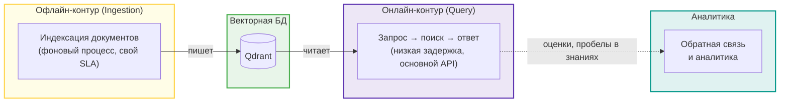

# Корпоративный поисковик по базе знаний

## 📌 Описание проекта
**Нейропомощник по нормативным документам** — это интеллектуальный корпоративный поисковик, который мгновенно отвечает на вопросы сотрудников и предоставляет экспертное мнение на основе нормативных актов компании (включая уставы, регламенты, должностные инструкции и политики). Система обеспечивает быстрый, удобный и безопасный доступ к актуальной информации, значительно сокращая время на поиск нужных регламентов.

## Векторное хранилище Qdrant
В рамках валидации архитектуры (sanity check) было проведено тестирование ранжирования `top-5` результатов на 5 реальных пользовательских запросах из предметной области для коллекций `documents_cosine` и `documents_dot`. Благодаря принудительной нормализации эмбеддингов (`normalize_embeddings=True`), списки выданных ID и их порядок полностью совпали для каждого тест-кейса, что подтверждает математическое тождество метрик на векторах единичной длины. Для финальной эксплуатации в production-среде утверждена метрика **Distance.DOT**, так как отсутствие в ней вычислительно тяжелых операций деления и извлечения корней позволяет эффективнее использовать векторные инструкции процессора (SIMD/AVX-512), гарантируя минимальный Latency в базе Qdrant при росте коллекции и RPS [результаты эксперимента](docs/vector_store.md).

## Архитектура RAG с LlamaIndex
Выбор архитектурного подхода для реализации RAG-системы:
* app/services/rag.py — версия на LlamaIndex
* app/services/rag_baremetal.py — та же логика без LlamaIndex.

На основе проведенного сравнительного анализа для практической реализации в рамках дипломного проекта была выбрана версия на базе фреймворка LlamaIndex [LlamaIndex vs bare-metal](docs/rag.md).

## Chunking и оптимизация качества

Подготовлен [golden dataset](tests/eval/retrieval_dataset_shot.json) на 20 вопросах из предметной области для измерения метрик: 
* Hit Rate@5 (доля запросов, где релевантный документ в top-k)
* MRR@10 (точность позиционирования релевантного документа в списке выдачи)
* Recall@10 (доля релевантных документов, попавших в в top-k)

Для оптимизации качества работы RAG-системы был проведен сравнительный эксперимент по выбору стратегии сегментации текста (chunking) и её параметров. Полные данные исследования приведены в документе [результаты эксперимента по чанкингу](docs/chunking_experiment.md).

На основе полученных метрик для итоговой реализации выбраны следующие архитектурные решения:

1. **Стратегия чанкинга**: Рекурсивный чанкинг текста (Recursive Character Text Splitter).
2. **Параметры**:
   * Размер чанка (Chunk Size): **512 токенов**
   * Перекрытие (Chunk Overlap): **64 токена**
3. **Этап переранжирования (Reranking)**:
   * **Инструмент**: Модель `bge-reranker-v2-m3`
   * **Параметры извлечения**: Первичный отбор `top_k = 20` документов для последующей переоценки реранкером.

##   Корпоративный RAG-ассистент

### Архитектура 

### Индексация документов app/services/ingestion.py 

#### Поддерживаемые форматы и кастомные парсеры (File Extractors)
Система поддерживает индексацию файлов индексацию файлов следующих форматов: `".pdf"`, `".docx"`, `".html"`, `".htm"`, `".txt"`, `".md"`.

Для повышения качества парсинга стандартные ридеры LlamaIndex были переопределены на специализированные библиотеки:

| Формат | Используемый класс | Особенности реализации / Обоснование выбора |
| :--- | :--- | :--- |
| **.pdf** | `PyMuPDFReader()` | Замена стандартного PDFReader на более быстрый и точный инструмент извлечения текста. Ответ ассистента будет цитировать источник постранично. |
| **.docx** | `UnstructuredReader()` | Замена базового DocxReader для корректного парсинга сложных структур, таблиц и списков |
| **.html** | `HTMLTagReader(tag="body")` | Ограничение парсинга только содержательной частью без мусорных тегов `head`, `script` и стилей |
| **.htm** | `HTMLTagReader(tag="body")` | Аналогично `.html` — извлечение только основного контента страницы |
| **.md** | `MarkdownReader()` | Извлечение логической структуры документа с сохранением Markdown-разметки |
| **.txt** | *Встроенный текстовый ридер* | Обрабатывается базовым ридером LlamaIndex по умолчанию |

#### Загружено в векторную базу

*   **Всего файлов :** 46
*   **Общий размер данных:** 76.72 МB
*   **Форматы:** 
    * .pdf: 30 шт.
    * .md: 11 шт.
 
#### Обогащение документов метаданными (Metadata Enrichment)
Создан  реестр документов [файл манифест json](app/data/documents.json) имитирует базу данных загруженного контента и содержит предопределенные метаданные о документах системы:
*   **Идентификатор и связи**: уникальный `id` документа, `parent_id` (для отслеживания связей) и тип связи (например, `attachment` для приложений).
*   **Тематические атрибуты**: официальный номер приложения, оригинальный заголовок (`title`), тип документа (например, `appendix`) и его иерархическая категория в системе знаний.
*   **Локатор**: абсолютный путь к файлу на диске.

В процессе парсинга для каждого файла вызывается функция обогащения, которая собирает итоговый словарь метаданных из двух источников:

1.  **Метаданные на основе файлового пути:**
    *   `source_file` — имя файла с расширением.
    *   `source_path` — полный путь к файлу.
    *   `doc_type` — тип документа, определяемый автоматически по структуре пути.
    *   `indexed_at` — дата проведения индексации в формате ISO.
    *   `folder_path` — относительный путь папки (вычисляется относительно корневой директории данных).
    *   `folder_parts` — массив (список) всех вложенных папок, из которых состоит путь. Это позволяет реализовывать каскадную фильтрацию по категориям любой вложенности.

2.  **Связывание с реестром (json):**
   * идентификатор документа (`id_document`)
   * заголовок (`title`) из реестра.
     
3. Шумные технические поля исключаются из эмбеддинга через excluded_embed_metadata_keys
#### Идемпотентная индексация
SimpleDocumentStore + DocstoreStrategy.UPSERTS
Для предотвращения дублирования данных и экономии ресурсов при повторных запусках пайплайна в системе реализована идемпотентная загрузка. Вместо полной перезаписи или слепого добавления документов используется связка хранилища документов **`SimpleDocumentStore`** и стратегии обновления **`DocstoreStrategy.UPSERTS`**.
*   **Хеширование контента**: При парсинге каждого файла LlamaIndex вычисляет уникальный хэш его содержимого (`doc_hash`).
*   **Проверка по базе данных**: Перед добавлением в индекс система сверяет текущие хэши файлов с записями, уже хранящимися в `SimpleDocumentStore`.
*   **Стратегия UPSERT (Обновление / Вставка)**: 
    *   Если файл *не изменился* (хэш совпадает), система полностью игнорирует его, избавляя от повторных затрат на генерацию эмбеддингов и обращений к API.
    *   Если файл *изменился*, старые чанки автоматически удаляются из индекса, а на их место записываются новые.
    *   Если файл *появился впервые*, он проходит стандартный цикл индексации.

#### End point
POST /documents/upload

### Онлайн-контур (Query): app/services/rag.py 
#### конвейер запроса

#### Пайплайн диалогового поиска (Query Rewriting):
`История диалога + Уточняющий вопрос` ➔ `Переписывание (Rewriting)` ➔ `Самостоятельный автономный вопрос` ➔ `Векторный поиск (Retrieval)` ➔ `Генерация ответа с контекстом и цитатами`

1) Диалоговый поиск (история + уточняющий вопрос)
2) переписывание вопроса: шаг condense опционален, если включается — один вызов LLM переписывает follow-up в самодостаточный вопрос с учётом окна истории
3) Поиск по векторной базе retrieval (top_k=10), гибридный ,  re-ranking (top_n=5)
4) Отказ до вызова LLM Реализован score-guard: если max(score) < SCORE_THRESHOLD — LLM-вызов пропускается и сразу отдаётся готовое сообщение. Значение threshold берётся из .env (rag_score_threshold)
5) Генерация ответа с нумерованными цитатами ([1], [2]). Цитаты делаются нумерованным контекстом и промптом с инструкцией цитировать
Интеграция
6) RAG подключен к Telegram-боту
7) endpoint POST /rag/query
обратная связь

аналитика

«Логирование и Трейсинг»

## Что еще сделать:
1) Реестр документов
