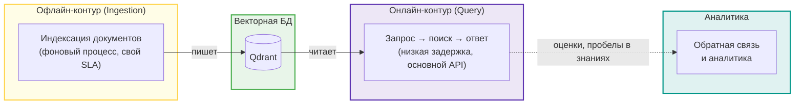
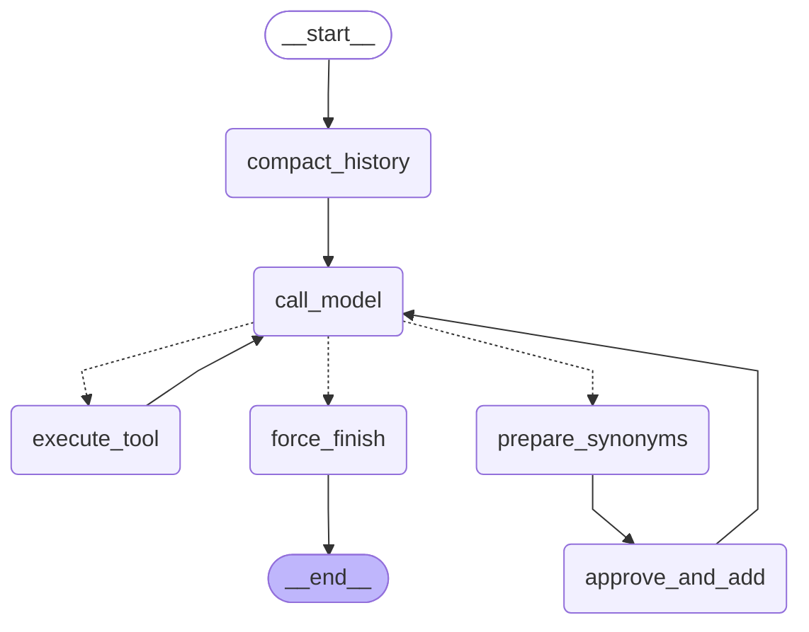

# Корпоративный поисковик по базе знаний

## Описание проекта
**Нейропомощник по нормативным документам** — это интеллектуальный корпоративный поисковик, который отвечает на вопросы сотрудников и предоставляет экспертное мнение на основе нормативных актов  (включая уставы, регламенты, должностные инструкции и политики). Система обеспечивает быстрый, удобный и безопасный доступ к актуальной информации, значительно сокращая время на поиск нужных регламентов.

### Команда запуска

Проект полностью контейнеризирован и разворачивается в едином контуре с помощью **Docker Compose**.

`docker compose up --build -d `

##   Корпоративный RAG-ассистент

### Архитектура 


На основе проведенного сравнительного анализа для практической реализации в рамках дипломного проекта была выбрана версия на базе фреймворка LlamaIndex.

[Таблица сравнения LlamaIndex vs bare-metal](docs/rag.md).

### Семантический поиск
 
1. Подготовлен [mini-benchmark](tests/eval/mini_benchmark.json): 5 пар в формате (query, relevant_doc, irrelevant_doc) из предметной области.
2. Выбрана 	open-source модель (EMBEDDING_MODEL): multilingual-e5-large.  
3. Порог релевантности (RAG_SCORE_TRESHOLD): 0.8 [калибровка порога](app/services/embeddings)
4. Подключение эмбеддингов в LlamaIndex
```
HuggingFaceEmbedding(
            model_name=model_path,
            text_instruction = "passage: ",
            query_instruction = "query: ",
            normalize = True
        )
```

### Векторное хранилище Qdrant
Проведено тестирование ранжирования `top-5` результатов на 5 реальных пользовательских запросах из предметной области для коллекций `documents_cosine` и `documents_dot`. Благодаря принудительной нормализации эмбеддингов (`normalize=True`), списки выданных ID и их порядок полностью совпали для каждого тест-кейса, что подтверждает математическое тождество метрик на векторах единичной длины  [Результаты эксперимента](docs/vector_store.md).

Выбрана метрика близости **Distance.DOT**, так как  обеспечивает максимальную скорость поиска без  лишних математических операций (вычисления корней и деления на длину вектора).

В коллекцию добавлен **Payload-индекс** для фильтрации документов по категориям.
```
client.create_payload_index(
                collection_name=settings.rag_collection,
                field_name="folder_parts",
                field_schema=models.PayloadSchemaType.KEYWORD,
            )
```
Коллекция Qdrant оптимизирована для **гибридного поиска:** нормализованные векторы модели E5 сравниваются по  метрике `Distance.DOT`, текстовый поиск BM25 интегрирован через выделенный разреженный индекс `"text-sparse-new"`, а граф связей HNSW (`m=16`, `ef_construct=100`) обеспечивает  баланс между точностью поиска и потреблением оперативной памяти.

### Chunking и оптимизация качества

Подготовлен [golden dataset](tests/eval/retrieval_dataset_shot.json) на 20 вопросах из предметной области для измерения метрик: 
* Hit Rate@5 (доля запросов, где релевантный документ в top-k)
* MRR@10 (точность позиционирования релевантного документа в списке выдачи)
* Recall@10 (доля релевантных документов, попавших в в top-k)

Для оптимизации качества работы RAG-системы был проведен сравнительный эксперимент по выбору стратегии сегментации текста (chunking) и её параметров. Полные данные исследования приведены в документе [результаты эксперимента по чанкингу](docs/chunking_experiment.md).

На основе полученных метрик для итоговой реализации выбраны следующие архитектурные решения:

1. **Стратегия чанкинга**: Рекурсивный чанкинг текста (Recursive Character Text Splitter).
2. **Параметры**:
   * Размер чанка (Chunk Size): **512 токенов**
   * Перекрытие (Chunk Overlap): **64 токена**
3. **Этап переранжирования (Reranking)**:
   * **Инструмент**: Модель `bge-reranker-v2-m3`
   * **Параметры извлечения**: Первичный отбор `top_k = 20` документов для последующей переоценки реранкером.

### Индексация документов app/services/ingestion.py 

#### Поддерживаемые форматы и кастомные парсеры (File Extractors)
Система поддерживает индексацию файлов индексацию файлов следующих форматов: `".pdf"`, `".docx"`, `".html"`, `".htm"`, `".txt"`, `".md"`.

Для повышения качества парсинга стандартные ридеры LlamaIndex были переопределены на специализированные библиотеки:

| Формат | Используемый класс | Особенности реализации / Обоснование выбора |
| :--- | :--- | :--- |
| **.pdf** | `PyMuPDFReader()` | Замена стандартного PDFReader на более быстрый и точный инструмент извлечения текста. Ответ ассистента будет цитировать источник постранично. |
| **.docx** | `UnstructuredReader()` | Замена базового DocxReader для корректного парсинга сложных структур, таблиц и списков |
| **.html** | `HTMLTagReader(tag="body")` | Ограничение парсинга только содержательной частью без мусорных тегов `head`, `script` и стилей |
| **.htm** | `HTMLTagReader(tag="body")` | Аналогично `.html` — извлечение только основного контента страницы |
| **.md** | `MarkdownReader()` | Извлечение логической структуры документа с сохранением Markdown-разметки |
| **.txt** | *Встроенный текстовый ридер* | Обрабатывается базовым ридером LlamaIndex по умолчанию |

Пустые, поврежденные или pdf файлы, которые не содержат текстового слоя (скан или картинка), переименовываются в .failed и видны в логах.

#### Обогащение документов метаданными (Metadata Enrichment)

Создан  реестр документов [файл манифест json](app/data/documents.json) имитирует базу данных загруженного контента и содержит предопределенные метаданные о документах системы:
*   **Идентификатор и связи**: уникальный `id` документа, `parent_id` (для отслеживания связей) и тип связи (например, `attachment` для приложений).
*   **Тематические атрибуты**: официальный номер приложения, оригинальный заголовок (`title`), тип документа (например, `appendix`) и его иерархическая категория в системе знаний.
*   **Локатор**: абсолютный путь к файлу на диске.

В процессе парсинга для каждого файла вызывается функция обогащения, которая собирает итоговый словарь метаданных из двух источников:

1.  Метаданные на основе файлового пути:
    *   `source_file` — имя файла с расширением.
    *   `source_path` — полный путь к файлу.
    *   `doc_type` — тип документа, определяемый автоматически по структуре пути.
    *   `indexed_at` — дата проведения индексации в формате ISO.
    *   `folder_path` — относительный путь папки (вычисляется относительно корневой директории данных).
    *   `folder_parts` — массив (список) всех вложенных папок, из которых состоит путь. Это позволяет реализовывать каскадную фильтрацию по категориям любой вложенности.

2.  Связывание с реестром (json):
   * идентификатор документа (`id_document`)
   * заголовок (`title`) из реестра.
     
3. Шумные технические поля исключаются из эмбеддинга через excluded_embed_metadata_keys

#### Идемпотентная индексация

Для предотвращения дублирования данных и экономии ресурсов при повторных запусках пайплайна в системе реализована идемпотентная загрузка. Вместо полной перезаписи или слепого добавления документов используется связка хранилища документов **`SimpleDocumentStore`** и стратегии обновления **`DocstoreStrategy.UPSERTS`**.
*   **Хеширование контента**: При парсинге каждого файла LlamaIndex вычисляет уникальный хэш его содержимого (`doc_hash`).
*   **Проверка по базе данных**: Перед добавлением в индекс система сверяет текущие хэши файлов с записями, уже хранящимися в `SimpleDocumentStore`.
*   **Стратегия UPSERT (Обновление / Вставка)**: 
    *   Если файл *не изменился* (хэш совпадает), система полностью игнорирует его, избавляя от повторных затрат на генерацию эмбеддингов и обращений к API.
    *   Если файл *изменился*, старые чанки автоматически удаляются из индекса, а на их место записываются новые.
    *   Если файл *появился впервые*, он проходит стандартный цикл индексации.

#### End point
POST /documents/upload

#### Визуализация RAG-корпуса
Загружено в векторную базу: 46 файлов (pdf: 30, md: 11), общий размер данных:76.72 МB


### Онлайн-контур (Query): app/services/rag.py 

#### конвейер запроса


* Диалоговый поиск (история + уточняющий вопрос)
* Переписывание вопроса: шаг condense опционален, если включается — один вызов LLM переписывает follow-up в самодостаточный вопрос с учётом окна истории
* Гибридный поиск (Hybrid Search) по векторной базе retrieval (top_k=10),re-ranking (top_n=5) **Модель:** `bge-reranker-v2-m3`
* Отказ до вызова LLM. Реализован score-guard: если max(score) < SCORE_THRESHOLD — LLM-вызов пропускается и сразу отдаётся готовое сообщение. Значение threshold берётся из .env (rag_score_threshold)
* Генерация ответа с нумерованными цитатами ([1], [2]). Цитаты делаются нумерованным контекстом и промптом с инструкцией цитировать

#### Интеграция c Telegram

* RAG подключен к Telegram-боту,  сообщение обновляется по мере генерации (SSE),  после финального чанка прикрепляются inline-кнопки 👍/👎.
* endpoint: **`POST /rag/query`** — принимает текстовый запрос пользователя, ищет релевантные чанки в Qdrant, генерирует ответ строго по контексту базы знаний, логирует результат в репозиторий аналитики и возвращает полный JSON-ответ с источниками.
  
#### Обратная связь и аналитика

1. Репозиторий аналитики:
* таблица **rag_queries**

2. Endpooint **GET /chats/admin/stats**:
* refusal_rate доля неуверенных RAG-ответов за окно
* knowledge_gaps топ вопросов без уверенного ответа — что добавить в базу знаний

3. Рhoenix-трейсинг: сервис phoenix добавлен в docker-compose.yml

### Оценка качества RAG

1. Через RAGAS TestsetGenerator сгенерированы данные для тестирования, проверены  вручную записями. Подготовлен итоговый датасет для тестирования [golden_dataset](tests/eval/golden_dataset.json):80 вопросов.
2. [Cкрипт](scripts/run_eval.py) прогоняет golden_dataset через  RAG, считает четыре метрики из ragas.metrics.collections : Faithfulness, AnswerRelevancy,  ContextPrecision, ContextRecall, кастомная метрика has_citation.

    Получены следующие метрики системы [результат](tests/eval/results/2026-09-22_1609_baseline_512.json):
*   **Faithfulness:** 0.79
*   **Answer Relevancy:** 0.73
*   **Context Precision:** 0.91
*   **Context Recall:** 0.72
*   **Factual_correctness:** 0.43
*   **Has Citation:** 0.91
*   **total_latency_sec:** 6.2 сек
*   **retrieval_latency_sec:** 3.5 сек
*   **generation_latency_sec:** 2.6 сек
   
3.  A/B-сравнение chunking: эксперимент A (базовая конфигурация, размер чанка 512), эксперимент B (размер чанка 1024) [результат](tests/eval/2026-09-23_1007_baseline_1024.json).
    A/B-сравнение re-ranker: эксперимент A (базовая конфигурация, re-ranker), эксперимент B (без re-ranker) [результат](tests/eval/results/2026-09-23_1609_baseline_no_rerank.json).
4. Failure analysis показал низкий Faithfulness при высоком Context Recall, что указывает на ошибку генерации (LLM-галлюцинацию) — поисковый модуль предоставил все необходимые данные, но языковая модель их исказила или проигнорировала.
5. Выявление галлюцинаций (HallucinationEvaluator): оценка записанных трейсов Phoenix [скрипт](app/observability/evaluate_traces_phoenix.py): [результат оценки](tests/eval/phoenix_Hallucination_evaluator.json).

Подробные сведения в документе: [Отчет по оценке качества RAG](docs/rag_evaluation.md).

##   Агент 

В проект входят следующие реализации агентов:
1. "Наивный" агент:  минимальная агентная обвязка  без фреймворков: один for-цикл вокруг вызова LLM, три инструмента, диспетчер по allowlist и пошаговая трасса. [Скрипт](app/services/agent_naive.py)
2. ReAct агент: поведение ReAct задаёт системный промпт, самопроверка (Self-reflection).[Скрипт](app/services/agent_react.py). [таблица сравнения результатов прогона "наивного" и ReAct агентов](docs/agent-react-report.md).  
3. 2 агента LangGraph: custom агент  и prebuild агент через langchain.agents.create_agent:
* [Скрипт](app/services/agent_graph.py)
* [Бенчмарк custom vs prebuilt](scripts/bench_agents.py)
* [Описание и результаты бенчмарка](docs/agent-graph-report.md)
4. Персистентный граф с HIL
5. Мультиагент: researcher (ищет факты через RAG-инструмент) и writer (собирает ответ с цитированием) — под супервизором через langgraph-supervisor:
* [Скрипт](app/agents/supervisor.py)
* [Бенчмарк single vs multi](experiments/test_agents.py)
* [Результаты бенчмарка ](docs/multi-agent-report.md)
    
### Персистентный граф с HIL

#### Cхема графа


#### Описание инструментов
* **get_knowledge_map** Возвращает структуру внутренней базы знаний в виде «категория → документы».
* **query_decomposition** Разбивает сложный пользовательский запрос на массив простых атомарных подзапросов.
* **query_rewriter** Превращает разговорный запрос в профессиональную поисковую фразу для multilingual-e5-base.
* **get_current_time** Текущие дата и время в указанном часовом поясе в формате ISO 8601.
* **add_custom_synonym** Обогащает лингвистическую базу корпоративного поискового движка (аббревиатуры, синонимы).
* **search_knowledge_base** Ищет ответ в корпоративной базе знаний по текстовому запросу (поиск в RAG).

[Полное описание инструментов](app/tools/graph_tools.py),  [поиск в RAG](app/agents/tools.py)

#### Узлы
* **START**	Точка входа	Начало работы графа, сразу передает управление на узел сжатия истории.
* **compact_history** Сжимает историю сообщений через LLM, если она превышает 20 сообщений, оставляя только последние 10 и саммари старых.
* **call_model** Вызывает LLM (с привязанными инструментами), считает итерации шагов.
* **execute_tool** Запускает стандартные инструменты и возвращает ответы ИИ-модели.
* **prepare_synonyms**  Перехватывает вызов "опасного" инструмента и готовит черновик данных для пользователя.
* **approve_and_add** Замораживает граф через interrupt, ждет одобрения человека. В случае согласия выполняет write_action в БД/файл.
* **force_finish**  Экстренно завершает работу агента (при достижении лимита итераций или отсутствии задач).
* **END**	Финал выполнения графа.

[Скрипт](app/services/agent_persistent.py)
[Отчет по разработке персистентного графа](docs/agent-persistent-report.md)

### Endpoints

* **POST agent/chat** прогон персистентного графа
* **POST agent/resume** возобновление после подтверждения человеком
* **POST agent/stream**  поток событий персистентного графа
* **POST agent/reseach** ответ мультиагента
## Таблица переменных окружения
Переменные окружения в [.env_example](.env.example)
## Осталось на будущее:
1) Реестр документов (добавление, удаление документов)
2) Подключение агентов к Telegram

